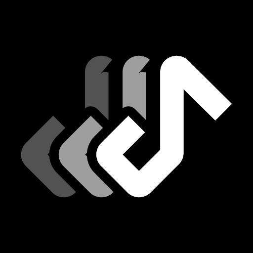

<div align="center">



# MetroQueue

### A YouTube Music client for Android with a smarter queue and a remote for your PC

[](https://github.com/Combustion-Robotics/MetroQueue/releases/latest)
[](LICENSE)
[](https://github.com/MetrolistGroup/Metrolist)

[**Download**](#download) · [**What's new**](#whats-different-from-metrolist) · [**Features**](#everything-from-metrolist) · [**Building**](#building) · [**Credits**](#credits)

</div>

---

MetroQueue is a fork of [Metrolist](https://github.com/MetrolistGroup/Metrolist), the Material 3 YouTube Music client. It keeps everything Metrolist does and adds a queue that works the way you'd expect: the songs you pick play first. It also adds a web remote, so you can control the music from any computer on your Wi-Fi.

Metrolist is moving on to Metrolist-KMP. MetroQueue carries the Android app forward from Metrolist 13.7.0.

## What's different from Metrolist

#### A queue that respects your picks
- **Play added songs first.** Songs you add go into your own "Next in queue" block right after the current song, ahead of radio, shuffled or album songs. *Play next* puts a song at the top of your block, and *Add to queue* puts it at the bottom.
- **Fresh radio after your picks** (optional). When your last pick starts, the held radio or shuffled songs are swapped for a new radio based on that song.
- **Queue sections.** The queue shows **Next in queue** and **Next from: …** headers, so you can see what you added and what's coming from the playlist or radio.
- **Clear queue.** One tap keeps the current song playing and removes everything else.

Turn these on in **Settings → Player and audio**.

#### Remote control from your PC
- Turn on **Settings → Integrations → Remote control** and open the link it shows on any browser on the same Wi-Fi. Nothing to install on the PC.
- See what's playing with the album art, and control play/pause, skip, seek, volume, shuffle and repeat.
- Manage the queue: jump to, move or remove songs, or clear it.
- Search YouTube Music and *Play*, *Play next* or *Add to queue* from the keyboard.
- The page looks like the app: Material 3, coloured from the current album art, light or dark to match your system.
- Keyboard shortcuts: <kbd>Space</kbd> play/pause, <kbd>Shift</kbd>+<kbd>←</kbd>/<kbd>→</kbd> previous/next.

> The remote uses plain HTTP and a secret key in the link. Use it on your home network, not on public Wi-Fi.

#### Builds
- Optimized, signed builds for every change: stable releases from `main`, and a rolling **dev Builds** pre-release from `dev`.
- The in-app updater checks MetroQueue's releases.

## Everything from Metrolist

<table>
  <tr>
    <td width="50%" valign="top">

#### Playback
- Stream any song or video from YouTube Music
- Background playback
- Download & cache for offline use
- Skip silence
- Sleep timer

</td>
    <td width="50%" valign="top">

#### Audio
- Audio normalization
- Tempo & pitch control
- Equalizer
- Crossfade

</td>
  </tr>
  <tr>
    <td width="50%" valign="top">

#### Lyrics & Discovery
- Live synced lyrics
- AI-powered lyrics translation
- Personalized quick picks
- Search songs, albums, artists, videos, and playlists

</td>
    <td width="50%" valign="top">

#### Library & Account
- Full library management
- Local playlists
- Import playlists
- Reorder songs in playlist or queue
- YouTube Music account login
- Sync songs, artists, albums, and playlists

</td>
  </tr>
  <tr>
    <td width="50%" valign="top">

#### Social
- Listen together with friends in real time
- Last.fm scrobbling
- Discord Rich Presence

</td>
    <td width="50%" valign="top">

#### Interface
- Home screen widgets
- Light / Dark / Black / Dynamic theme modes
- Dynamic color + preset color palettes
- Built with Material 3

</td>
  </tr>
</table>

## Download

| Channel | App | Get it |
|---|---|---|
| **Stable** | MetroQueue | [Latest release](https://github.com/Combustion-Robotics/MetroQueue/releases/latest) → `MetroQueue.apk` |
| **Beta** | MetroQueue Beta | [dev Builds](https://github.com/Combustion-Robotics/MetroQueue/releases/tag/dev-builds), updated on every change to `dev` |

- **They're separate apps.** MetroQueue and MetroQueue Beta can be installed at the same time, and next to the official Metrolist.
- **Coming from Metrolist?** In Metrolist, go to **Settings → Backup and restore**, make a backup, then restore it in MetroQueue.
- **Android version.** Android 8.0 or newer is required.

## Building

You need JDK 21 and the Android SDK.

```bash
git clone https://github.com/Combustion-Robotics/MetroQueue
cd MetroQueue
git submodule update --init --recursive

# Signing key for local builds (keep this file; updates must be signed with the same key)
keytool -genkeypair -v -keystore app/persistent-debug.keystore -storepass android -keypass android \
  -alias androiddebugkey -keyalg RSA -keysize 2048 -validity 10000 -dname "CN=Android Debug,O=Android,C=US"

./gradlew :app:assembleFossRelease   # optimized APK in app/build/outputs/apk/foss/release/
./gradlew :app:assembleFossDebug     # debug build (much slower UI, for development only)
```

**Branches:** work happens on `dev`, and `main` gets stable releases. To publish a new release, bump `versionName` in `app/build.gradle.kts` and merge into `main`.

**CI:** CI needs a `DEV_KEYSTORE_BASE64` repository secret (your keystore, base64-encoded). Without it, builds are signed with a throwaway key. Optional `LASTFM_API_KEY` and `LASTFM_SECRET` secrets enable Last.fm.

## Credits

MetroQueue exists thanks to **[Metrolist](https://github.com/MetrolistGroup/Metrolist)**, created by **[Mo Agamy](https://github.com/mostafaalagamy)** with [its contributors](https://github.com/MetrolistGroup/Metrolist/graphs/contributors). Almost everything in this app is their work. If you like it, go give them a star.

Metrolist itself builds on:

- **[InnerTune](https://github.com/z-huang/InnerTune)** by Zion Huang and Malopieds
- **[OuterTune](https://github.com/DD3Boh/OuterTune)** by Davide Garberi and Michael Zh
- **[Better Lyrics](https://better-lyrics.boidu.dev)**: time-synced, word-by-word lyrics
- **[metroserver](https://github.com/MetrolistGroup/metroserver)**: the Listen Together backend
- **[MusicRecognizer](https://github.com/aleksey-saenko/MusicRecognizer)**: music recognition
- **[zemer-cipher](https://github.com/ZemerTeam/zemer-cipher)**: YouTube cipher deobfuscation and PoToken generation

…and the wider open-source community behind every library this app uses.

## License

MetroQueue is free software under the [GNU General Public License v3.0](LICENSE), like Metrolist. You may use, study, share and improve it under the same terms.

## Disclaimer

This project is **not affiliated with, funded, authorized or endorsed by** YouTube, Google LLC, Metrolist Group LLC, or any of their affiliates. All trademarks belong to their respective owners.
